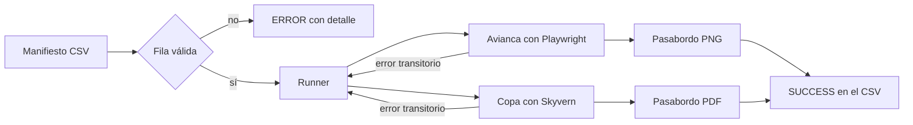

# Check-in automático de aerolíneas con Playwright y Skyvern (RPA para agencias de viajes)

[](https://github.com/KevinAndrey96/typescript-playwright-airline-checkin-rpa/actions/workflows/ci.yml)


[](LICENSE)

**Robot de automatización (RPA) que hace el check-in web de muchos pasajeros a partir de una hoja de cálculo** y guarda cada pasabordo con un nombre ordenado. Está pensado para agencias de viajes que todos los días abren el portal de cada aerolínea, escriben el código de reserva, llenan los datos del pasajero, esquivan ofertas y descargan pasabordos uno por uno.

- **Avianca** con [Playwright](https://playwright.dev): el robot recorre el formulario real paso a paso (reserva, contacto, equipaje, datos personales, documento de viaje, contacto de emergencia, silla y pasabordo).
- **Copa Airlines** con [Skyvern](https://www.skyvern.com): un agente de navegación con modelos de visión recibe los datos del pasajero y devuelve el pasabordo descargado.

## Qué hace

- **Manifiesto CSV validado:** cada fila es un pasajero. Antes de abrir el navegador se validan código de reserva, documento, fechas reales, correo, teléfonos y que el pasaporte tenga vencimiento. Los errores se explican en español y por columna.
- **Estado por pasajero en el mismo archivo:** el robot escribe `PENDING`, `IN_PROGRESS`, `SUCCESS` o `ERROR`, el código del error, el número de intentos y la ruta del pasabordo. Puedes abrir el CSV en Excel para ver el avance.
- **Reanudable:** si el proceso se corta, la siguiente ejecución retoma los pasajeros que quedaron a medias y omite los que ya tienen pasabordo.
- **Reintentos con espera exponencial** solo para errores transitorios (página lenta, sin red, pasabordo que no cargó). Los errores que requieren a una persona (reserva inexistente, CAPTCHA, pago exigido, documentos adicionales) no se reintentan.
- **Pasabordos ordenados:** `boarding_passes/avianca/AV123X_GOMEZ-HERRERA_ALEJANDRO.png`. Cuando algo falla queda una captura en `boarding_passes/errores/` para revisar qué vio el robot.
- **Pasajeros ya registrados:** si el check-in ya estaba hecho, el robot abre "Ver pasabordos" y lo descarga igual.
- **Un archivo a la vez:** el manifiesto queda bloqueado durante la ejecución y cada guardado es atómico, así dos procesos nunca escriben el mismo archivo.

## Uso

Requisitos: Node.js 22 o superior.

```bash
npm ci
npx playwright install chromium
cp .env.example .env
cp examples/passengers.example.csv data/passengers.csv   # reemplázalo con tus pasajeros

npm run build
node dist/cli.js validate     # revisa el manifiesto sin abrir el navegador
node dist/cli.js run          # hace el check-in de los pendientes
node dist/cli.js run --airline avianca
```

Al terminar se imprime un resumen:

```text
Resumen del check-in
  Pasajeros en el manifiesto: 12
  Exitosos:                   10
  Con error:                  1
  Omitidos:                   1
  Pasabordos en:              boarding_passes
```

El código de salida es `0` si todo salió bien, `1` si algún pasajero quedó con error y `2` ante un problema de configuración. Los registros salen en JSON por la salida de errores, sin documentos, correos ni teléfonos.

### Con Docker

```bash
cp examples/passengers.example.csv data/passengers.csv
docker compose run --rm checkin validate
docker compose run --rm checkin run
```

La imagen parte de la imagen oficial de Playwright, compila TypeScript en una etapa aparte y corre como el usuario sin privilegios `pwuser`. En Linux, las carpetas `data/` y `boarding_passes/` deben permitir escritura al usuario 1000 del contenedor.

## El manifiesto

Copia [`examples/passengers.example.csv`](examples/passengers.example.csv); los datos del ejemplo son ficticios.

| Columna | Ejemplo | Regla |
| :--- | :--- | :--- |
| `airline` | `avianca` | `avianca` o `copa` |
| `reservation_code` | `AV123X` | 5 a 10 letras o números |
| `last_name`, `first_name` | `GOMEZ HERRERA`, `ALEJANDRO` | Como aparecen en la reserva |
| `document_type`, `document_number` | `CC`, `1098765432` | `CC`, `CE`, `PA` o `TI` |
| `document_nationality`, `document_issuing_country` | `Colombia` | Texto del país |
| `document_expiry_date` | `2031-10-15` | `AAAA-MM-DD`; obligatorio para pasaporte |
| `birth_date` | `1992-05-14` | `AAAA-MM-DD` |
| `gender` | `M` | `M`, `F` o `X` |
| `residence_country`, `visit_purpose` | `Colombia`, `Turismo` | `Turismo`, `Negocios`, `Estudios` o `Transito` |
| `email`, `phone` | `pasajero@example.com`, `+573001234567` | Correo válido; 7 a 15 dígitos |
| `emergency_contact_*` | `Mariana Gomez`, `+57`, `3109876543`, `Colombia` | Nombre, indicativo, teléfono y país |
| `seat_preference` | `WINDOW` | `WINDOW`, `AISLE`, `MIDDLE` o `NONE` |

Las columnas de estado (`checkin_status`, `checkin_date`, `boarding_pass`, `error_code`, `error_message`, `attempt_count`, `last_attempt_date`) las llena el robot. Para reintentar un pasajero después de corregir sus datos, pon su `checkin_status` en `PENDING`.

### Códigos de error

| Código | Se reintenta | Qué hacer |
| :--- | :---: | :--- |
| `ERR_INVALID_DATA` | No | Corregir la fila según el mensaje. |
| `ERR_RESERVATION_NOT_FOUND` | No | Verificar código y apellido con el pasajero. |
| `ERR_CHECKIN_CLOSED`, `ERR_FLIGHT_CANCELLED` | No | El vuelo no admite check-in web en este momento. |
| `ERR_PAYMENT_REQUIRED`, `ERR_REQUIRES_DOCUMENTS`, `ERR_CAPTCHA` | No | Terminar el check-in manualmente. El robot nunca paga ni resuelve CAPTCHAs. |
| `ERR_TIMEOUT`, `ERR_NETWORK` | Sí | El mensaje indica en qué paso se detuvo. |
| `ERR_BOARDING_PASS_MISSING`, `ERR_AUTOMATION_FAILED`, `ERR_UNKNOWN` | Sí | Revisar la captura en `boarding_passes/errores/`. |

## Copa con Skyvern

1. Levanta un servidor de [Skyvern](https://github.com/Skyvern-AI/skyvern) (local o en la nube) y crea una clave de API.
2. Configura `SKYVERN_API_URL` y `SKYVERN_API_KEY` en `.env`.
3. Elige el modo:
   - `COPA_MODE=task` (por defecto): el robot envía una tarea con todos los datos del pasajero, instrucciones explícitas de no pagar servicios adicionales y un esquema de extracción para saber si el check-in terminó.
   - `COPA_MODE=workflow`: usa un workflow publicado en Skyvern (`COPA_WORKFLOW_ID=wpid_...`). `node dist/cli.js skyvern-workflows` lista los disponibles. El workflow recibe `reservation_code`, `last_name`, `first_name`, `email`, `phone` y `seat_preference`.

El cliente de Skyvern tiene tiempo límite por petición, reintenta con espera exponencial los errores transitorios y **nunca repite un POST que el servidor pudo haber aceptado**, para no lanzar dos veces el mismo check-in. La clave de API solo se envía al propio servidor de Skyvern, nunca a las URL de descarga de terceros. Un check-in de Copa solo queda exitoso si hay un pasabordo descargado o el agente confirma que está disponible.

## Arquitectura

```text
src/
├── domain/          Pasajero (esquema Zod), estados y catálogo de errores
├── manifest/        Lectura y escritura del CSV con bloqueo y guardado atómico
├── runner/          Orquestación: qué filas procesar, reintentos y resumen
├── airlines/
│   ├── avianca/     Flujo de Playwright por pasos y selectores con alternativas
│   └── copa/        Peticiones a Skyvern y evaluación del resultado
├── browser/         Chromium con un contexto aislado por pasajero
├── skyvern/         Cliente de la API v1 de Skyvern
├── config.ts        Variables de entorno validadas
└── app.ts           Comandos run, validate y skyvern-workflows
```



Cada aerolínea implementa la misma interfaz `AirlineAdapter`, así agregar otra es escribir un adaptador nuevo sin tocar el runner. Los selectores de Avianca viven en un solo archivo, ordenados del más específico al más genérico, y cada paso del flujo tiene nombre para que un error diga exactamente dónde se detuvo.

## Pruebas y calidad

```bash
npm run lint        # ESLint con reglas estrictas de typescript-eslint
npm run typecheck   # TypeScript estricto
npm test            # pruebas unitarias
npm run test:e2e    # check-in completo con Chromium contra un sitio de prueba
```

- **87 pruebas unitarias:** validación del manifiesto, clasificación de los mensajes de la aerolínea, bloqueo y guardado del CSV, reglas de reintento del runner, cliente de Skyvern contra un servidor HTTP local (sondeo, reintentos, tiempo límite y que la clave no salga a otros dominios), adaptador de Copa y comandos de la consola.
- **6 pruebas de punta a punta** con Chromium contra una réplica local del check-in de Avianca con los mismos componentes de Angular Material. Verifican campo por campo lo que el robot escribió, el pasajero ya registrado, la reserva inexistente, el documento rechazado, el pasabordo que nunca carga y una ejecución completa del comando `run` sobre un CSV.
- CI en Node 22 y 24, construcción de la imagen Docker con Chromium como `pwuser` y Dependabot.

## Uso responsable

Este robot hace lo mismo que haría un asesor en el navegador, a ritmo humano y con una pausa entre pasajeros. No evade sistemas antibots, no resuelve CAPTCHAs y no paga servicios. Úsalo solo con reservas de pasajeros que te autorizaron a hacer su check-in y revisa los términos de uso de cada aerolínea. Los manifiestos y los pasabordos contienen datos personales: la carpeta `data/` y `boarding_passes/` están fuera del control de versiones.

## Historia del proyecto

La primera versión (junio de 2026) fue un robot en JavaScript para Avianca con Playwright y un plugin de evasión; en octubre se sumó un segundo robot para Copa con Skyvern. Cada uno tenía su propia configuración, registro y lectura del CSV, y el flujo de Avianca dependía de esperas fijas y de textos de un vuelo concreto para detectar el pasabordo. En noviembre de 2026 lo reescribí en TypeScript estricto como una sola herramienta: manifiesto validado y reanudable, catálogo de errores, reintentos solo donde tienen sentido, un cliente de Skyvern seguro, pruebas de punta a punta y despliegue en contenedor. La versión original queda en la etiqueta `v0.1-legacy`.

## Autor

**Kevin Andrey Herrera Silva**, desarrollador backend. [GitHub](https://github.com/KevinAndrey96)

## Licencia

[MIT](LICENSE)
